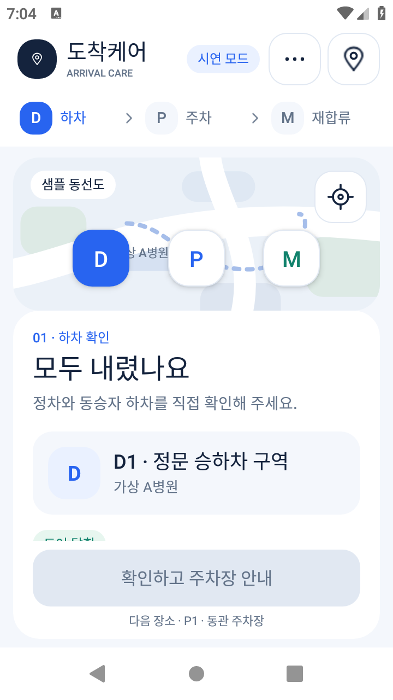
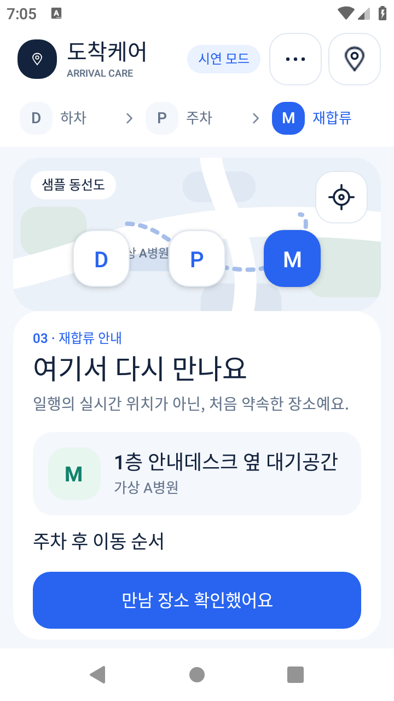
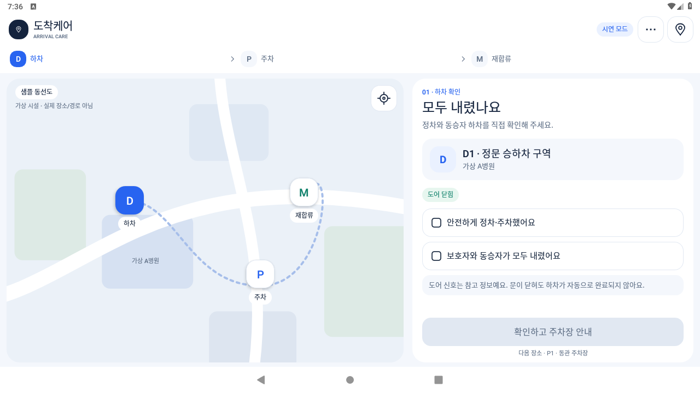

# 도착케어 · Arrival Care v0.2.0

**함께 내리고, 주차하고, 다시 만나는 도착 경험.** Kotlin Android / HMG AppDev Challenge MVP.

세로 화면에는 지도 위·안내 카드 아래, 넓은 가로 창에는 지도 왼쪽·안내 패널 오른쪽을 배치합니다. 조건 설정부터 하차·주차의 직접 확인, 처음 약속한 만남 장소까지 실제 상태 머신으로 연결됩니다.

> 가상 A병원·B쇼핑몰을 이용하는 시연 앱입니다. 경로·도착·demo 차량 신호는 시뮬레이션입니다. 카카오 키가 없어 이번 APK는 샘플 동선도를 표시합니다. 실차 운행용 내비게이션이나 검증된 시설 접근성 안내가 아닙니다.

## 다운로드

- [v0.2.0 Release · APK / 영상 / 소스](https://github.com/junyong290/arrival-care-mvp/releases/tag/v0.2.0)
- [바로 실행하는 시연 APK · offline](https://github.com/junyong290/arrival-care-mvp/releases/download/v0.2.0/arrivalcare-demo-offline-0.2.0.apk)
- [Kakao SDK 포함 APK · ARM 전용](https://github.com/junyong290/arrival-care-mvp/releases/download/v0.2.0/arrivalcare-demo-kakao-arm-0.2.0.apk)
- [실제 실행 영상 · 64초](https://github.com/junyong290/arrival-care-mvp/releases/download/v0.2.0/arrivalcare-demo-0.2.0.mp4)
- [실제 검증 결과와 한계](docs/VERIFICATION_V0_2.md) · [카카오 키 발급·해시 설정](docs/KAKAO_SETUP.md)
- [v0.1.0 Release](https://github.com/junyong290/arrival-care-mvp/releases/tag/v0.1.0)와 [당시 검증 기록](docs/VERIFICATION.md)은 보존했습니다.

## 화면

| 세로 · 계획 | 세로 · 하차 확인 | 세로 · 재합류 |
|---|---|---|
|  |  |  |



실제 APK 실행 화면입니다. 실제 스마트폰 검증은 사용자의 요청에 따라 후속 진행하며, 에뮬레이터 검증과 구분합니다.

## Android Studio에서 실행

JDK **17**, Android SDK **34**, Build Tools **34.0.0**, Gradle Wrapper **8.7**, AGP **8.5.2**, Kotlin **1.9.24**. 최소 API **28**.

1. 저장소를 Android Studio에서 열고 SDK 경로를 `local.properties`에 설정합니다.
2. Build Variants에서 **demoOfflineDebug**를 선택해 실행합니다. 별도 서비스 키가 필요 없습니다.
3. 실제 카카오 지도는 [설정 안내](docs/KAKAO_SETUP.md)에 따라 키와 패키지·인증서 해시를 등록하고 **demoKakaoDebug**를 ARM 기기에서 실행합니다.

```powershell
.\gradlew.bat :app:assembleDemoOfflineDebug :app:testDemoOfflineDebugUnitTest :app:lintDemoOfflineDebug
adb install -r app/build/outputs/apk/demoOffline/debug/app-demo-offline-debug.apk
adb shell am start -n ai.arrivalcare.app.demo/ai.arrivalcare.app.MainActivity
```

macOS/Linux에서는 `./gradlew`를 사용합니다. Android Studio 프로젝트를 제공하며 검증 빌드는 Gradle CLI와 GitHub Actions로 수행했습니다. IDE GUI 실행 검증과는 구분합니다.

| 변형 | 사용 환경 | 지도 | 차량 신호 / 경로 |
|---|---|---|---|
| `demoOffline` | 일반 Android, x86/ARM 시연 | 샘플 동선도 | Mock / Mock |
| `demoKakao` | ARM Android + 등록된 키 | Kakao 2.15.2, 오류 시 샘플 | Mock / Mock |
| `pleosOffline` | Pleos SDK 연결 진단 | 샘플 동선도 | 실제 SDK 어댑터 / Mock |
| `pleosKakao` | ARM Pleos + 등록된 키 | Kakao 2.15.2, 오류 시 샘플 | 실제 SDK 어댑터 / Mock |

Kakao 네이티브 라이브러리는 **arm64-v8a / armeabi-v7a** 전용입니다. x86_64 Pleos 에뮬레이터에는 **offline** APK를 사용합니다. 실제 타일은 키 등록과 ARM 기기의 후속 검증이 필요합니다. Kakao APK는 키가 없거나 연결 실패 시 대체 화면으로 돌아갑니다. 같은 integration의 두 APK는 패키지 ID가 같아 서로 업데이트됩니다.

## 시연 흐름

1. **가상 A병원** 선택. 아래로 스크롤하여 **동행 조건 변경**에서 부모님 / 별도 보호자 있음 / 먼저 내려주기를 확인합니다.
2. **이 계획으로 안내 시작 → 하차 지점 도착**.
3. 안전한 정차와 동승자·보호자 하차를 각각 체크하고 **확인하고 주차장 안내**.
4. **주차장 도착**, 안전한 주차를 체크하고 **주차 완료 · 만남 장소 보기**.
5. 처음 정한 **1층 안내데스크 옆 대기공간** 확인 후 완료.

별도 보호자 없음 또는 함께 이동하기를 선택하면 하차를 생략합니다. 아이·유모차·휠체어 조건에 따라 유의사항이 바뀝니다. D/P/M 마커는 상세 정보를 열며 여정을 임의로 진행하지 않습니다. 오른쪽 위 **···**는 시뮬레이터, 핀 아이콘은 새 여정, 지도 배지는 지도 연결 상태입니다.

## 실제 구현과 시뮬레이션

| 기능 | 구현 범위 |
|---|---|
| 반응형 UI | 실제 앱 창 크기로 배치 결정, 지도 인스턴스 유지, 스크롤 본문·고정 주요 버튼, 터치 피드백·단계 전환 |
| 여정 상태 | 기존 `Journey.kt`와 22개 테스트 원문 보존. 추천·확인·재시도·늦은 응답 무시 |
| D/P/M | 대체 동선도 버튼과 Kakao SDK label 클릭. 모두 가상 샘플 위치 |
| Kakao 지도 | 실제 SDK·MapView·마커·수명주기·실패 복구 코드 컴파일. 키 미발급으로 타일 인증 미검증 |
| 차량 신호 — demo | `MockVehicleGateway`에서 도어·주행·연결 실패 시뮬레이션 |
| Vehicle — pleos | SDK 2.3.2 초기화·Door capability 조회 어댑터. 서비스 연결 성공 미검증 |
| 주행 제한 — pleos | AAOS `CarUxRestrictionsManager`. 신호 미확인 시 입력 잠금 |
| NaviHelper — pleos | SDK 3.0.5 초기화·목적지 정보 조회 진단. 실제 `requestRoute` 호출 없음 |
| 경로·도착 — 모든 APK | `MockNavigationGateway`와 시연 도착 버튼. 지도 표시와 실제 경로 안내 분리 |
| 접근성 정보 | 미검증 표시, 현장 안내 확인 요구. 승하차 허용·단차·통로 폭 보장 없음 |
| 실시간 일행 위치·음성·실내 측위 | 미구현 |

## 안전·창 전환

- 도어 신호만으로 하차가 완료되지 않습니다. 문 열림은 진행을 막고, 신호 누락은 추가 직접 확인을 요구합니다.
- 주행 중 조건 변경·하차·주차 확인·지도 조작·여정 초기화를 제한합니다. 시뮬레이터의 주행/정차 전환은 테스트 도구입니다.
- 요청 ID와 목적지 ID를 검사하여 이전 요청의 늦은 콜백을 무시합니다.
- 회전·창 크기 변경으로 여정을 잃지 않습니다. 백그라운드 전환과 저장 상태 복원 시 안전 확인 체크는 해제합니다.
- 고정 가로 방향·전체 화면 강제를 제거했습니다. Pleos Driving view와 시스템 창 제어를 덮지 않습니다. 실제 Pleos 멀티윈도우 검증 여부는 보고서에 별도 기록합니다.

## 검증 재실행

```powershell
.\gradlew.bat :app:testDemoOfflineDebugUnitTest :app:lintDemoOfflineDebug
python tools/adb_v02_scenarios.py --serial DEVICE_SERIAL --out evidence/v0.2.0/portrait
python tools/adb_v02_scenarios.py --serial DEVICE_SERIAL --orientation landscape --only happy --out evidence/v0.2.0/landscape
```

UI 스크립트는 새 UIAutomator 계층의 실제 버튼을 터치합니다. 테스트 앱 여정을 초기화하며 끝나면 회전 설정을 복원합니다. 상태 머신 22개에 반응형·지도 실행 조건 테스트 10개를 추가했습니다.

`--only rotate`는 에뮬레이터에서 실제 창 크기를 가로·세로로 변경한 뒤 원래 크기·밀도로 복원합니다. headless API 28에서 회전 설정이 무시되는 경우를 구분합니다. 이 검사는 실제 Pleos 멀티윈도우 검증과 다릅니다. 현재 창 방향을 유지하려면 `--orientation current`를 사용합니다.

## 서명·구조

기본 Release 빌드는 unsigned입니다. 개인 키로 서명하려면 Git에서 제외된 `signing.properties`에 `storeFile`, `storePassword`, `keyAlias`, `keyPassword`를 설정합니다. 제공 APK는 v0.1.0과 같은 시연용 인증서로 서명했습니다. 제조사 승인·앱마켓 인증을 뜻하지 않습니다.

| 경로 | 역할 |
|---|---|
| `app/src/main/.../domain/Journey.kt` | 추천·상태 머신 |
| `app/src/main/.../ui/` | 디자인·창 크기 정책·상태 복원 |
| `app/src/main/.../maps/MapPanel.kt` | 대체 지도·공통 상태·실패 복구 |
| `app/src/kakao/` / `app/src/offline/` | Kakao MapView / SDK 없는 공급자 |
| `app/src/demo/` / `app/src/pleos/` | Mock / 차량 SDK 어댑터 |
| `tools/adb_v02_scenarios.py` | 실제 UI 검증 |

[화면 설계](docs/UI_V0_2.md) · [Pleos 멀티윈도우](https://document.pleos.ai/docs/pleos-only/vehicle-app-planning-guide/app-structure-screen-model) · [Kakao 시작](https://apis.map.kakao.com/android_v2/docs/getting-started/quickstart/)

개인정보·동의서·서명 이미지·개인 키·로컬 인증 정보는 저장소와 소스 ZIP에 포함하지 않습니다. 로그인·분석 SDK·사용자 데이터 업로드 기능은 없습니다. Kakao 변형은 지도 서비스를 위해 네트워크를 사용합니다.
