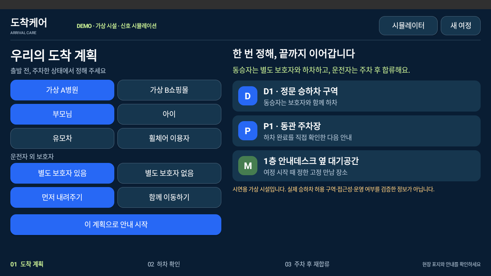
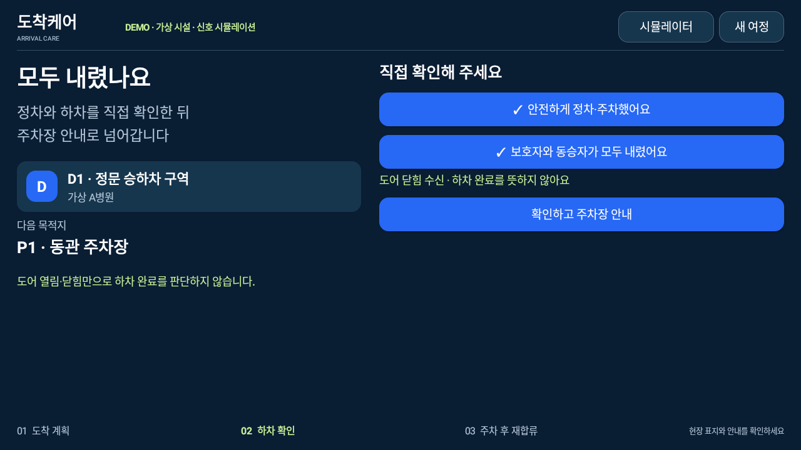
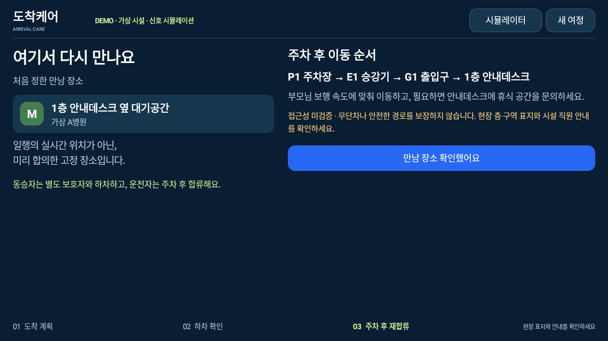

# 도착케어 · Arrival Care

**동승자 하차부터 주차 후 재합류까지 이어 주는 Kotlin 차량용 MVP.**

현대자동차그룹 HMG AppDev Challenge 출품 준비용 프로토타입입니다. 기획안 13쪽의 네이비·블루 화면을 Android 네이티브 UI로 구현했습니다. 정적 화면이 아니라 조건과 사용자 확인에 따라 진행하는 상태 머신을 사용합니다.

> 시연에는 **demo** 빌드를 사용합니다. A병원과 B쇼핑몰은 가상의 시설이며, 도어·주행·경로·도착 신호는 화면에 표시된 시뮬레이션입니다. 실제 도로에서 사용할 수 있는 내비게이션이나 검증된 시설 접근성 안내가 아닙니다.

## 바로 확인하기

- [서명된 시연 APK](https://github.com/junyong290/arrival-care-mvp/releases/download/v0.1.0/arrivalcare-demo-0.1.0.apk)
- [실제 실행 영상 · 78초](https://github.com/junyong290/arrival-care-mvp/releases/download/v0.1.0/arrivalcare-demo-78s.mp4)
- [Android Studio 소스 ZIP](https://github.com/junyong290/arrival-care-mvp/releases/download/v0.1.0/arrivalcare-source-0.1.0.zip)
- [설치·실행·SDK 검증 보고서](docs/VERIFICATION.md)

서명 Release APK를 API 28 에뮬레이터에 설치해 실제 UI 시나리오 **8개**를 통과했습니다. 상태 머신 단위 테스트는 **22개 통과**했습니다. Pleos SDK 연결 상태는 위 보고서에서 별도로 확인하세요.

| 도착 계획 | 명시적 하차 확인 | 주차 후 재합류 |
|---|---|---|
|  |  |  |

## 실행

1. Android Studio에서 이 폴더를 엽니다.
2. JDK **17**, Android SDK Platform **34**, Build Tools **34.0.0**을 설치합니다.
3. `local.properties`에 로컬 Android SDK 경로를 설정하거나 Android Studio가 생성하도록 합니다.
4. Build Variants에서 **demoDebug**를 선택합니다.
5. API 28 이상 장치/에뮬레이터에서 실행합니다. 핵심 시연 환경은 1280×720 가로형 AOSP Android 9(API 28)입니다.

```powershell
.\gradlew.bat :app:assembleDemoDebug :app:testDemoDebugUnitTest :app:lintDemoDebug
adb install -r app/build/outputs/apk/demo/debug/app-demo-debug.apk
adb shell am start -n ai.arrivalcare.app.demo/ai.arrivalcare.app.MainActivity
```

macOS/Linux에서는 `./gradlew`를 사용합니다. Gradle Wrapper **8.7**, AGP **8.5.2**, Kotlin **1.9.24**, `minSdk=28`, `targetSdk=34`를 고정했습니다. 처음 빌드할 때 Google Maven·Maven Central에 접속합니다. `pleos` 변형은 Pleos 공개 Maven도 사용합니다.

## 1분 시연 흐름

1. **가상 A병원 / 부모님 / 별도 보호자 있음 / 먼저 내려주기**를 선택합니다.
2. **이 계획으로 안내 시작 → [시연] 하차 지점 도착**을 누릅니다.
3. 필요하면 **시뮬레이터 → 도어 열림/닫힘**을 바꿉니다. 이것만으로 단계가 바뀌지 않습니다.
4. **안전하게 정차·주차했어요**, **보호자와 동승자가 모두 내렸어요**를 직접 체크합니다.
5. **확인하고 주차장 안내 → [시연] 주차장 도착**을 누릅니다.
6. 주차 완료를 직접 확인하고 **주차 완료 · 만남 장소 보기**를 누릅니다.
7. 출발 때 정한 **1층 안내데스크 옆 대기공간**과 이동 유의사항을 확인합니다.

**별도 보호자 없음**을 고르면 ‘먼저 내려주기’를 선택하더라도 **함께 이동하기**로 추천하며, 하차 단계를 생략합니다. 유모차·휠체어·아이 조건에 따라 이동 유의사항이 달라집니다. 병원과 쇼핑몰은 각각 다른 하차·주차·만남 지점을 사용합니다.

## 실제 구현과 시뮬레이션 구분

| 항목 | 구현 범위 |
|---|---|
| Kotlin Android 화면·버튼 | 네이티브 View, 가로 화면, 스크롤 가능한 큰 조작 영역 |
| 조건별 추천 | 동승자 복수 선택, 보호자 유무, 선호 방식, 시설에 따라 실제 상태 변경 |
| 하차·주차 확인 | 사용자의 명시적 확인을 상태 머신에서 검사 |
| 재합류 | 처음 확정한 고정 장소 유지, 조건별 이동 주의 문구 |
| 도어·주행 신호 — demo | `MockVehicleGateway`, 시뮬레이터에서 직접 변경 |
| 경로·도착 — 두 빌드 | `MockNavigationGateway`와 시연 도착 버튼. 실제 지도 탐색·GPS 도착 감지 없음 |
| NaviHelper — pleos | 공개 SDK 3.0.5를 실제 의존성으로 사용. 초기화 및 목적지 정보 조회 콜백을 시도하는 읽기 전용 연결 진단. 실경로 요청은 수행하지 않음 |
| Vehicle — pleos | 공개 SDK 2.3.2 초기화, Door capability 확인, 지원 도어 위치 조회. 반환값·누락·타임아웃을 구분 |
| 주행 제한 — pleos | 실제 AAOS `CarUxRestrictionsManager`. 연결 미확인 시 입력 잠금. 물리적 주차 감지와 구분 |
| 시설·접근성 데이터 | 가상 fixture. 실제 시설의 승하차 허용, 무단차, 통로 폭, 승강기 운영을 보장하지 않음 |
| 실시간 일행 위치 / 음성 / 실내 측위 | 미구현 |

`pleos`는 SDK 연결 진단용 개발 변형입니다. 이 PC에서는 설치와 Activity 실행 반환값까지 확인했으며, 정상 UI 표시와 Vehicle·NaviHelper 연결은 확인하지 못했습니다. **시연은 검증된 `demo` APK를 사용하세요.** 설치·실행 결과와 남은 제약은 [검증 보고서](docs/VERIFICATION.md)에 기록합니다.

## 안전 상태 전환

```text
SETUP → ROUTING_DROPOFF → EN_ROUTE_DROPOFF → EXIT_CHECK
                                                 ↓ 명시적 하차 확인
          ROUTING_PARKING → EN_ROUTE_PARKING → PARKING_CHECK
                                                 ↓ 명시적 주차 확인
                                            REUNION → DONE

별도 보호자 없음 / 함께 이동 선택: SETUP → ROUTING_PARKING
```

- 주행 상태 또는 UX 제한 연결 미확인 상태에서는 조건 변경·하차·주차 확인을 차단합니다.
- 도어 열림/닫힘은 하차 완료를 자동으로 만들지 않습니다. 열린 문이 있으면 진행을 막습니다.
- 도어 신호 누락/연결 실패 시 직접 문을 확인하는 추가 체크가 필요합니다.
- 경로 실패·타임아웃에는 같은 단계에서 재시도합니다. 요청 ID와 목적지 ID가 모두 일치해야 결과를 반영합니다.
- 실패한 요청의 늦은 성공, 이전 여정 응답, 중복 콜백은 단계를 바꾸지 못합니다.
- 주행 시작 또는 앱이 백그라운드로 이동하면 안전 확인 체크를 해제합니다.
- 프로세스가 종료돼 앱이 다시 생성되면 여정을 초기화합니다. 미확인 하차를 완료 상태로 복구하지 않습니다.
- 차량 도어·브레이크 등 구동 장치를 제어하지 않습니다. 주행 중 사용 가능 승인을 받은 앱으로 선언하지 않습니다.

## 예외 시연 및 검증

오른쪽 위 **시뮬레이터**에서 주행/정차, 도어 열림/닫힘/누락/연결 실패, 다음 경로 요청 실패/응답 지연을 선택할 수 있습니다. 응답 지연은 타임아웃 후 늦은 콜백을 보내며, 재시도 후에도 이전 응답이 무시되는지 확인할 수 있습니다.

```powershell
python tools/adb_scenarios.py --serial emulator-5558 --out evidence
python tools/adb_scenarios.py --serial emulator-5558 --out evidence --video
```

실제 기기의 UI 계층을 읽고 터치하는 검증 스크립트입니다. 이미지로 화면을 합성하지 않습니다. `--video`는 Android `screenrecord`로 화면을 녹화합니다. Python 3와 ADB가 필요합니다. 검증 기기 외에 다른 기기가 연결돼 있으면 `--serial`을 정확히 지정합니다.

## Pleos 개발 환경

- [공식 시작 가이드](https://document.pleos.ai/docs/pleos-only/getting-started)
- [Pleos Connect 2.1.0 설치](https://document.pleos.ai/docs/connect/guide/getting-started/application-development/setup-connect-sdk-emulator)
- [그래픽 사양·Cold boot](https://document.pleos.ai/docs/connect/guide/getting-started/application-development/configure-pleos-connect-emulator)
- [NaviHelper 가져오기](https://document.pleos.ai/docs/pleos-only/connect-sdk-pleos/NaviHelper/importing-sdk)
- [Vehicle 가져오기](https://document.pleos.ai/docs/pleos-only/connect-sdk-pleos/Vehicle/project-setup)

SDK 저장소: `https://nexus-playground.pleos.ai/repository/maven-releases/`

`pleosDebug` / `pleosRelease`를 빌드하면 Vehicle·NaviHelper SDK가 포함됩니다. 정상 Pleos 환경에서 연결 상태를 확인해야 합니다. 일반 Android에서는 차량 플랫폼 없음과 SDK 연결 실패가 예상되며, 입력 잠금이 유지됩니다. 가상 시설에 임의의 실제 좌표를 붙이지 않기 때문에 NaviHelper의 `requestRoute`는 호출하지 않습니다. 실제 내비게이션을 연결하려면 검증된 시설·하차·주차 좌표, 해당 서비스 권한, 목적지 검증과 현장 검증을 먼저 추가해야 합니다.

## Release 서명

기본 checkout에서 Release는 서명되지 않습니다. 자신의 배포 키로 `signing.properties`를 생성하면 Release 빌드에 적용됩니다.

```properties
storeFile=C:/private/arrivalcare.jks
storePassword=YOUR_PASSWORD
keyAlias=arrivalcare
keyPassword=YOUR_PASSWORD
```

키 파일과 `signing.properties`는 Git에서 제외됩니다. 제공하는 서명 APK는 시연 배포용 전용 키로 서명한 것이며 앱마켓 승인·자동차 제조사 서명을 뜻하지 않습니다.

## 코드 위치

| 위치 | 역할 |
|---|---|
| `app/src/main/.../domain/Journey.kt` | Android에 의존하지 않는 추천·상태 머신 |
| `app/src/main/.../data/Gateways.kt` | SDK 교체 지점과 비동기 mock 구현 |
| `app/src/main/.../MainActivity.kt` | 기획안 기반 3개 화면과 주차·경로 보조 화면 |
| `app/src/demo/` | SDK 없이 독립적으로 실행되는 시연 변형 |
| `app/src/pleos/` | 실제 SDK 진단·도어 조회·AAOS 제한 어댑터 |
| `app/src/test/` | 상태 전환·안전 조건·비동기 오류 자동 테스트 |
| `tools/adb_scenarios.py` | 실제 ADB UI 시나리오와 녹화 |

개인정보·동의서·서명 이미지·SDK 바이너리·로컬 인증 정보는 저장소에 포함하지 않습니다. 본 앱에는 로그인, 서버 업로드, 분석 SDK가 없습니다.
