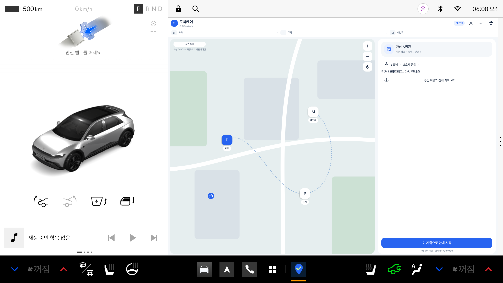
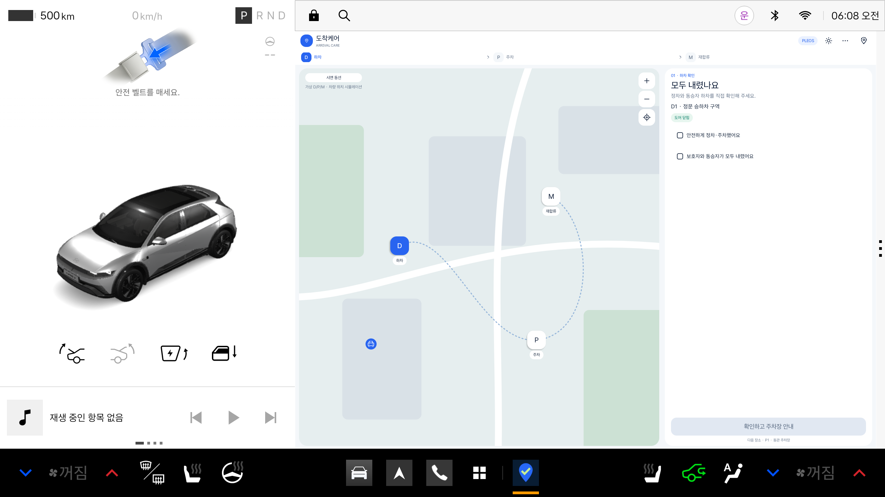
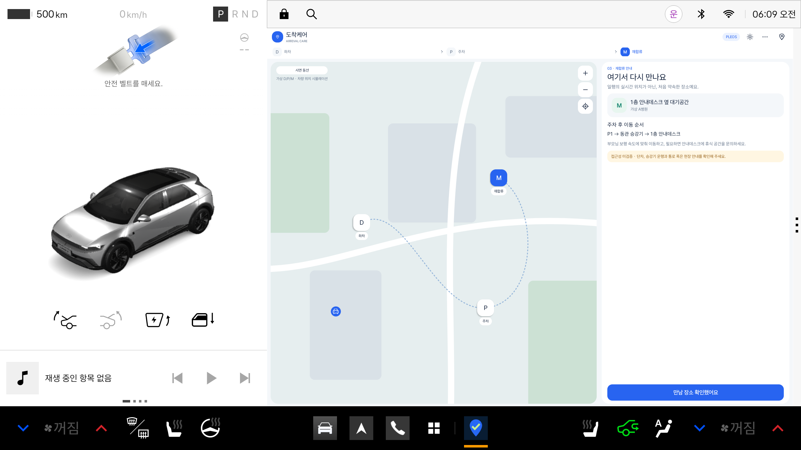
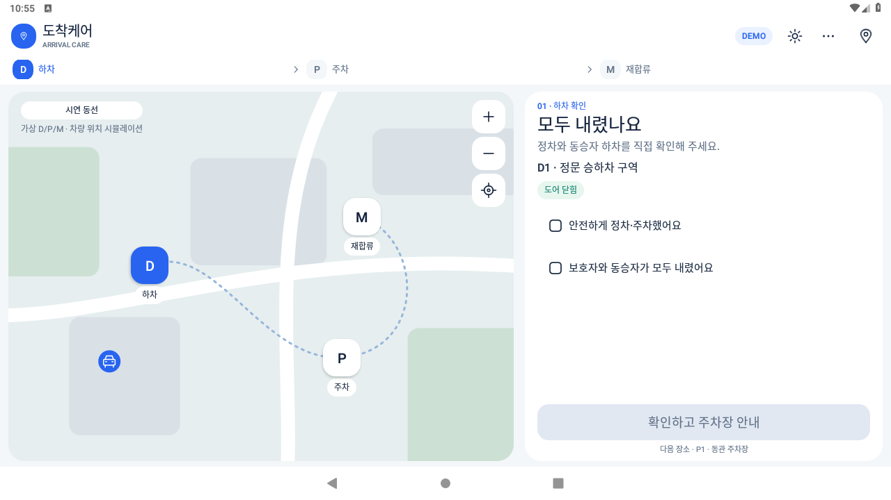
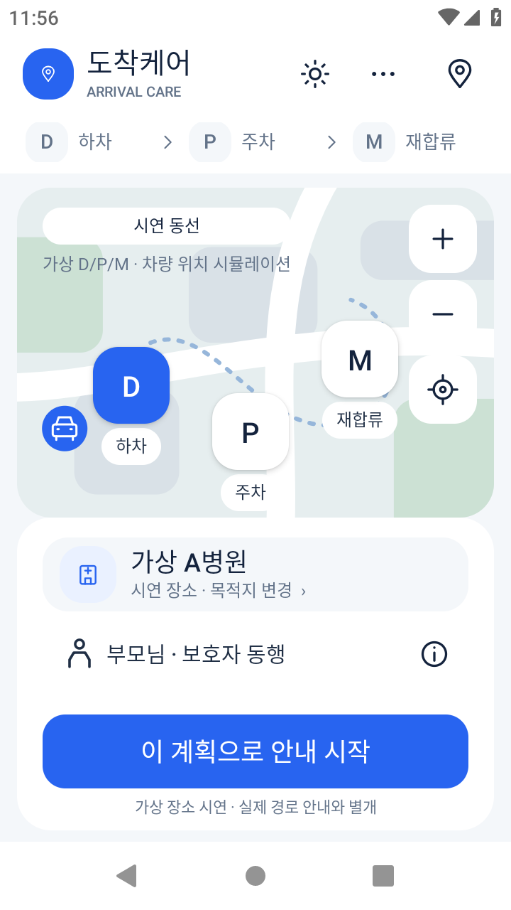
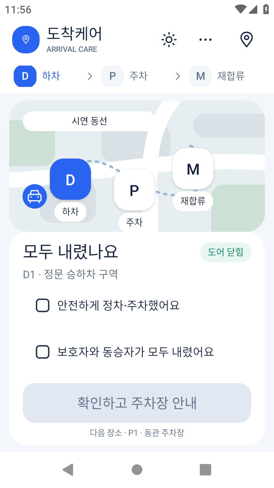
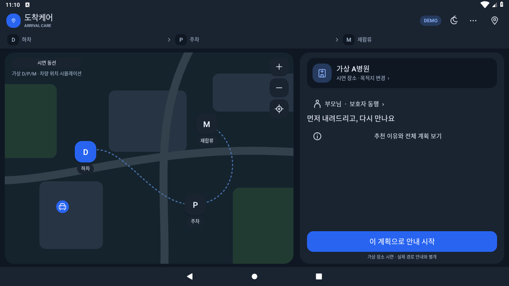

# 도착케어 · Arrival Care v0.3.1

**동승자의 상황에 맞춰 하차·주차·재합류를 하나의 여정으로 연결하는 차량용 도착 관리 앱.**

참가팀 **Unrival** · 앱 **도착케어(Arrival Care)** · **v0.3.1** · Kotlin Android / HMG AppDev Challenge MVP.

**[Pleos 제출용 APK 다운로드](https://github.com/junyong290/arrival-care-mvp/raw/refs/heads/codex/mvp/apk/Unrival_%EB%8F%84%EC%B0%A9%EC%BC%80%EC%96%B4_release.apk)** · `Unrival_도착케어_release.apk`

**공식 Pleos 2.1.0 에뮬레이터에서 최종 서명 APK의 설치 해시 일치와 핵심 UI 검사 3개를 통과했습니다.** 부모님 하차 → 주차 → 재합류 → 완료, 직접 확인 전 진행 금지, 유일 보호자의 하차 생략을 확인했습니다. [실행 결과](https://github.com/junyong290/arrival-care-mvp/actions/runs/43721867358)

## 공모전 제출 정보

| 항목 | 내용 |
|---|---|
| GitHub 저장소 | https://github.com/junyong290/arrival-care-mvp |
| 제출 APK 경로 | [`apk/Unrival_도착케어_release.apk`](apk/Unrival_도착케어_release.apk) |
| 제출 APK 다운로드 | [Unrival_도착케어_release.apk 다운로드](https://github.com/junyong290/arrival-care-mvp/raw/refs/heads/codex/mvp/apk/Unrival_%EB%8F%84%EC%B0%A9%EC%BC%80%EC%96%B4_release.apk) |
| 빌드 종류 | 서명된 `pleosOfflineRelease`, versionName `0.3.1`, versionCode `4`, `debuggable=false` |
| Android 패키지 | `ai.arrivalcare.app.pleos` |
| 파일 크기 | 8,759,249 bytes — 저장소 `apk/`에 직접 포함 |
| 실행 환경 | Pleos Connect Emulator 2.1.0 / Android API 34 / x86_64 |
| 보조 산출물 | [이전 v0.3.0: 일반 Android 데모·Kakao ARM 빌드·AOSP 시연 영상](https://github.com/junyong290/arrival-care-mvp/releases/tag/v0.3.0) |

v0.3.1은 실제 내비 모드를 선택하기 전에는 NaviHelper를 초기화하지 않도록 변경한 **Pleos용 빌드**입니다. 초기 검사에서는 Pleos 홈 앱이 실행한 OEM 내비가 전면에 있었으며, 시스템 초기화를 기다린 뒤 같은 APK로 전체 여정을 확인했습니다. [APK 서명·해시 기록](apk/SUBMISSION_APK.json), [v0.3.1 검증 보고서](docs/VERIFICATION_V0_3_1.md), [제출 안내](docs/SUBMISSION.md)를 제공합니다. 소스 코드는 저장소 루트와 `app/`에 포함되어 있습니다.

## 제출 APK 설치·실행

1. **Pleos Connect Emulator 2.1.0 / API 34 / x86_64**를 부팅하고 홈 화면과 기본 앱의 초기화가 끝나기를 기다립니다. 검증에서는 부팅 완료 후 120초를 추가로 기다렸습니다. 위 APK를 설치하고 **도착케어**를 실행하며, 차량 UX 제한 신호가 확인되어 입력이 허용될 때 진행합니다.
2. 기본 조건인 **가상 A병원 / 부모님 / 별도 보호자 있음 / 먼저 내려주기**로 시작합니다.
3. **이 계획으로 안내 시작 → 동의하고 시연 경로 요청 → 하차 지점 도착(시연)** 순서로 진행합니다.
4. 정차·동승자 하차를 직접 확인한 뒤 **확인하고 주차장 안내**를 누르고, 주차 경로를 별도로 승인합니다. 도어 신호가 없거나 연결이 끊겼다면 문이 닫혔다는 추가 확인도 필요합니다.
5. 주차장 도착과 주차 완료를 확인하면 처음 지정한 만남 장소가 표시됩니다. **만남 장소 확인했어요**를 누르면 여정이 완료됩니다.

ADB로 설치할 경우 저장소 루트에서 실행합니다.

```powershell
adb install -r "apk/Unrival_도착케어_release.apk"
adb shell am start -n ai.arrivalcare.app.pleos/ai.arrivalcare.app.MainActivity
```

**제출 APK는 Pleos 차량 서비스 환경용입니다.** 로그인·카카오 키는 필요하지 않으며 지도는 가상 동선도입니다. 도어는 Vehicle SDK, 입력 제한은 Car UX 서비스를 사용하고, 기본 경로·도착은 명시된 시뮬레이션입니다. 실제 서울아산병원 선택 시 미검증 승하차·접근성 정보로 계획을 만들지 않고 보류합니다.

일반 Android 스마트폰·태블릿에서 화면을 시연하려면 별도의 [이전 v0.3.0 Offline 데모 APK](https://github.com/junyong290/arrival-care-mvp/releases/download/v0.3.0/arrivalcare-demo-offline-0.3.0.apk)를 사용합니다. 이 보조 앱은 차량 신호까지 Mock이며 제출용 Pleos APK와 패키지가 다릅니다.

## 테스트 환경과 필요한 설정

| 환경 | 버전·화면 규격·설정 | 확인 결과 |
|---|---|---|
| v0.3.1 제출 Release / Pleos | **Pleos Connect Emulator 2.1.0 / API 34 / x86_64 / 2560×1440 / 160dpi / RAM 4GB**, Android Emulator **35.6.11**, Ubuntu KVM·소프트웨어 GPU | [설치 해시 일치·핵심 UI 검사 3/3 통과](https://github.com/junyong290/arrival-care-mvp/actions/runs/43721867358). Car UX 입력 허용·Vehicle SDK 4개 도어 CLOSED 조회 확인 |
| v0.3.1 빌드·단위 테스트 | JDK 17, Gradle 8.7, AGP 8.5.2, Kotlin 1.9.24, Android SDK 34 | [네 가지 Release 빌드·48개 단위 테스트·lint 통과](https://github.com/junyong290/arrival-care-mvp/actions/runs/43720052027). CI 빌드와 최종 서명 APK의 실제 실행 검사는 구분 |
| 이전 v0.3.0 demo / Pleos | Pleos 2.1.0 / API 34 / x86_64 / **2560×1440 / 160dpi** | [서명 APK 설치 해시 일치·부모님 전체 여정·직접 확인·유일 보호자 흐름 통과](https://github.com/junyong290/arrival-care-mvp/actions/runs/43718641093). demo의 차량 신호·경로는 Mock |
| 이전 v0.3.0 demo 가로 | AOSP API 28 / x86_64, Emulator 35.6.11, **1280×720 / 160dpi** | **15/15 통과**, 67.36초 실제 화면 녹화. v0.3.1 Pleos APK 결과가 아님 |
| 이전 v0.3.0 소스 세로 | Ubuntu KVM / API 28 / x86_64 / **720×1280 / 320dpi**, CI debug 인증서 | **4/4 통과**. v0.3.1 제출 APK와 버전·인증서·바이너리가 다름 |

가로·세로 레이아웃은 앱 창 크기에 따라 전환됩니다. 실제 카카오 지도를 사용하는 보조 ARM 빌드는 [키·패키지·서명 해시 설정](docs/KAKAO_SETUP.md)이 필요하며, **실제 ARM 스마트폰의 지도 타일 표시는 아직 미검증**입니다. Pleos SDK는 Vehicle **2.3.2**, NaviHelper **3.0.5**입니다. [새 검증 보고서](docs/VERIFICATION_V0_3_1.md)와 [이전 Windows Pleos 진단·AOSP 기록](docs/VERIFICATION_V0_3.md)을 구분합니다.

## 서비스 소개

지도 위의 목적지 하나를 가족의 **하차 → 주차 → 재합류** 계획으로 연결합니다. 세로에서는 지도 위·안내 카드 아래, 넓은 가로 창에서는 지도 왼쪽·안내 패널 오른쪽으로 전환합니다. 정차 중 선택한 동행 조건에 따라 장소와 순서가 달라지고, 하차·주차는 사용자가 직접 확인합니다.

> 가상 A병원/B쇼핑몰의 D/P/M, 이동·도착 신호, demo 차량 상태는 시뮬레이션입니다. 서울아산병원은 공식 대표 위치와 확인된 정보만 표시하며, 미검증 승하차·접근성 정보로 경로를 만들지 않습니다. 카카오 지도 타일 표시와 실제 차량 내비게이션 경로 요청은 별개입니다. 실제 검증 범위는 [v0.3.1 보고서](docs/VERIFICATION_V0_3_1.md)를 확인하세요.

## v0.3.1 실제 Pleos 실행 화면

| 도착 계획 | 하차 직접 확인 | 재합류 안내 |
|---|---|---|
|  |  |  |

[전체 여정 완료](evidence/v0.3.1/pleos/pleos/05-complete.png) · [유일 보호자와 함께 이동](evidence/v0.3.1/pleos/pleos/06-together.png) · [설치 해시·검사 원본](evidence/v0.3.1/pleos/runtime-result.json)

## 이전 v0.3.0 보조 다운로드와 실행 화면

- [v0.3.0 Release — APK·영상·소스](https://github.com/junyong290/arrival-care-mvp/releases/tag/v0.3.0)
- [Offline 데모 APK](https://github.com/junyong290/arrival-care-mvp/releases/download/v0.3.0/arrivalcare-demo-offline-0.3.0.apk)
- [Kakao SDK 포함 ARM APK](https://github.com/junyong290/arrival-care-mvp/releases/download/v0.3.0/arrivalcare-demo-kakao-arm-0.3.0.apk)
- [67초 실제 앱 시연 영상 — 부모님 방문 전체 여정](https://github.com/junyong290/arrival-care-mvp/releases/download/v0.3.0/arrivalcare-demo-0.3.0.mp4)
- [카카오 키·패키지·서명 해시 설정](docs/KAKAO_SETUP.md)
- [v0.2.0 대비 개선과 시설 근거](docs/UI_V0_3.md)



| 세로 계획 | 세로 하차 | 다크 테마 |
|---|---|---|
|  |  |  |

위 이미지와 67초 영상은 **이전 v0.3.0 일반 Android 환경**에서 실제 실행한 기록입니다. 새 Pleos 제출 APK의 검증 증거로 대신하지 않습니다. 기존 [v0.1.0](https://github.com/junyong290/arrival-care-mvp/releases/tag/v0.1.0), [v0.2.0](https://github.com/junyong290/arrival-care-mvp/releases/tag/v0.2.0), [v0.3.0](https://github.com/junyong290/arrival-care-mvp/releases/tag/v0.3.0) Release를 보존합니다.

## Android Studio / CLI

JDK **17**, Android SDK **34**, Build Tools **34.0.0**, Gradle Wrapper **8.7**, AGP **8.5.2**, Kotlin **1.9.24**, 최소 API **28**.

1. Android Studio에서 저장소 루트를 엽니다.
2. `local.properties`에 SDK 경로를 설정하고 Pleos에서는 `pleosOfflineDebug`를 선택합니다. 일반 Android 시연은 `demoOfflineDebug`입니다.
3. 실제 카카오 지도는 [콘솔 설정](docs/KAKAO_SETUP.md) 후 ARM 기기에서 `demoKakaoRelease`를 설치합니다. debug/Release 인증서 해시를 구분합니다.

```powershell
.\gradlew.bat :app:testDemoOfflineDebugUnitTest :app:lintDemoOfflineDebug
.\gradlew.bat :app:assembleDemoOfflineRelease :app:assembleDemoKakaoRelease
.\gradlew.bat :app:assemblePleosOfflineRelease :app:assemblePleosKakaoRelease
```

macOS/Linux에서는 `./gradlew`를 사용합니다. 비공개 `signing.properties`가 없으면 Release는 unsigned입니다. 개인 서명으로 빌드할 경우 설치된 APK 해시를 카카오 콘솔에 다시 등록해야 합니다. Gradle CLI/CI 검증과 Android Studio IDE GUI 실행 검증은 구분합니다.

| 변형 | 환경 | 지도 | 차량·내비 |
|---|---|---|---|
| `demoOffline` | 일반 Android ARM/x86 | 가상 동선도 | Mock |
| `demoKakao` | ARM + 등록된 네이티브 키 | Kakao 2.15.2, 오류 시 대체 화면 | Mock |
| `pleosOffline` | Pleos 플랫폼 / 제출 대상 | 가상 동선도 | 실제 Vehicle SDK·Car UX / 기본 시연 내비, 명시적 실연동 선택 |
| `pleosKakao` | ARM Pleos + 등록된 키 | Kakao, 오류 시 대체 화면 | 위와 동일 |

Kakao SDK ABI는 **arm64-v8a / armeabi-v7a**입니다. x86_64 Pleos Emulator에는 Offline APK를 사용합니다. 같은 integration의 Offline/Kakao APK는 패키지명이 같아 서로 업데이트되며, demo와 pleos는 별도 설치됩니다. CI 기본 APK는 키를 포함하지 않습니다. 키가 포함된 로컬 APK의 실제 타일 검증 여부는 보고서에 기록합니다.

## 세 가지 시연

1. **부모님 + 별도 보호자 + 가상 A병원**: 계획 확인 → 시연 경로 승인 → 하차 지점 도착 → 정차·동승자 하차 직접 확인 → 주차 경로 별도 승인 → 주차 완료 확인 → 처음 지정한 만남 장소 → 완료.
2. **휠체어 + 보호자 없음**: 동행 조건에서 선택 → 하차 생략 확인 → 시뮬레이터에서 접근성 정보 누락 → 계획 보류. 가상 접근성 정보를 복원하면 승강기 연결 주차장부터 함께 이동합니다.
3. **실패 복구**: 기본 시연 내비 모드에서 다음 요청 실패/지연을 선택할 수 있습니다. 도어·주행 상태의 앱 내부 Mock 전환은 `demo` 보조 앱에만 제공됩니다. `pleos`는 실제 플랫폼 신호와 연결 실패 상태를 사용하며, 미확인 하차는 진행되지 않고 오래된 응답은 무시합니다.

상단 **화면 테마**에서 라이트/다크/시스템을 선택합니다. D/P/M 마커를 누르면 장소 상세, 지도 상태를 누르면 연결 진단과 현재 APK의 키 해시를 확인합니다. 실제 서울아산병원 선택 시 H 대표 위치만 표시하며 도착 계획은 보류됩니다.

## 구현과 시뮬레이션 구분

| 기능 | 구현 | 실연동 검증 범위 |
|---|---|---|
| 상태 전환·조건별 추천·사용자 동의 | 실제 Kotlin 로직 | 단위·실행 UI 검사 |
| 반응형 지도/안내, 테마, 마커 상세, 줌 | 실제 Android UI | 캡처·실행 기록 참조 |
| Kakao 지도 | SDK MapView·마커·수명주기·오류 처리 | ARM 실제 타일 확인은 별도 기록 |
| D/P/M 좌표·접근성 | 가상 시설 fixture | 실제 시설 추천으로 사용하지 않음 |
| 실제 병원 정보 | 공식 주소·대표 위치·사실 | 미검증 승하차·무단차 정보는 보류 |
| demo 도어·주행·도착·경로 결과 | 분리된 Mock | 시뮬레이터임을 표시 |
| Pleos 도어 | Vehicle 2.3.2 주기 조회·이벤트·구독 해제 | 실제 신호 수신 검증은 보고서 참조 |
| 차량 입력 제한 | Android Car UX Restrictions | 연결 미확인 시 조작 잠금 |
| 실제 차량 위치 | NaviHelper 읽기 전용 조회, 신선도 제한 | 차량 서비스·권한 필요, phone GPS 아님 |
| 실제 차량 경로 | NaviHelper 3.0.5 requestRoute·완료/목적지 검증 | 검증된 좌표·POI·권한·서비스·사용자 동의 필요. 현재 실시설 D/P 미검증으로 요청 차단 |

실연동 요청이 실패했다고 성공한 Mock 요청으로 자동 대체하지 않습니다. SDK 전역 이벤트에는 요청 ID가 없어 구독 세대·요청 토큰·목적지 일치 확인을 함께 사용합니다. 실제 서비스의 이벤트 순서와 동시 외부 경로 변경은 차량 환경에서 추가 검증해야 합니다. 내비 도착 이벤트에 의한 자동 단계 전환은 실연동 모드에서 아직 활성화하지 않았습니다.

## 구조와 재현

- `domain/Journey.kt`: 상태 머신, 안전 확인, 요청 토큰, 경로 승인.
- `domain/ArrivalRecommendationEngine.kt`: 조건별 추천, 시설 근거, 실제 경로 검증 정책.
- `maps/MapPanel.kt`와 flavor별 `MapProvider`: 지도 어댑터·샘플 대체·수명주기.
- `data/Gateways.kt`, demo/pleos 소스셋: 실제 SDK와 Mock 분리.
- `ui/SessionState.kt`: 계획·진행 복원. 물리적 안전 확인과 미승인 경로는 자동 복원하지 않음.
- `tools/adb_v03_scenarios.py`: 실제 화면 터치 기반 UI 시나리오.
- `tools/record_v03.py`: 같은 기기·화면에서 관찰한 터치로 실제 녹화.
- `tools/check_pleos_v03.py`: 설치 해시·앱 실행·SDK 로그·Virtual Console 진단.
- `tools/setup_pleos_ci.py`, `tools/verify_pleos_runtime.py`: 공식 Pleos 이미지·설치된 APK 해시·실제 화면 터치 시나리오 검증.

```powershell
python tools/adb_v03_scenarios.py --adb adb --serial DEVICE --orientation current --out evidence/v0.3.0/my-device
python tools/kakao_key_hash.py path/to/app.apk --sdk path/to/android-sdk
```

공식 문서: [Pleos 시작하기](https://document.pleos.ai/docs/pleos-only/getting-started), [Pleos 레이아웃](https://document.pleos.ai/docs/connect/guide/docs-design/getting-started/layout), [NaviHelper 목적지](https://document.pleos.ai/docs/pleos-only/connect-sdk-pleos/NaviHelper/destinations), [Kakao SDK 시작하기](https://apis.map.kakao.com/android_v2/docs/getting-started/quickstart/).
